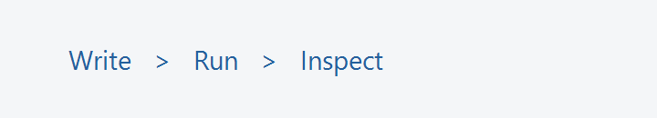

# Values you can see

A C program begins in `main`. Try changing the value below, then choose **Run**.

C 程式從 `main` 開始執行。試著修改下方的數值，再選擇 **Run**。



This code is for reading. Open the exercise to edit its source file.

此處的程式碼僅供閱讀。請開啟練習以編輯來源檔案。

```c
int value = 7;
printf("Value: %d\n", value);
```
